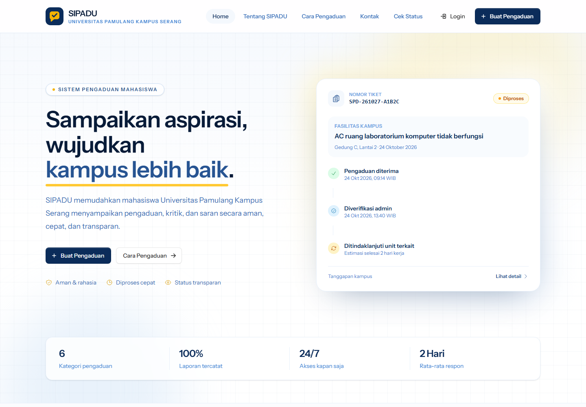
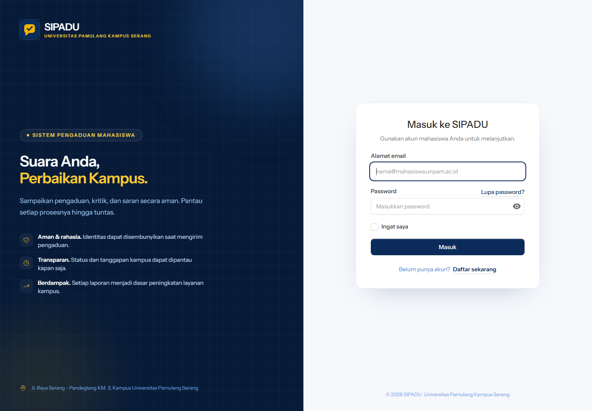
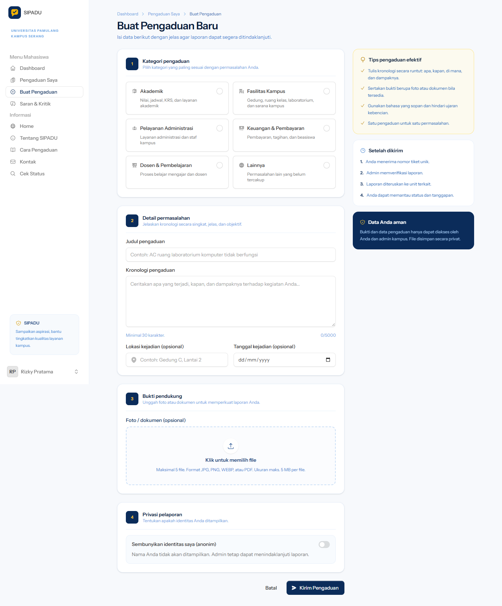
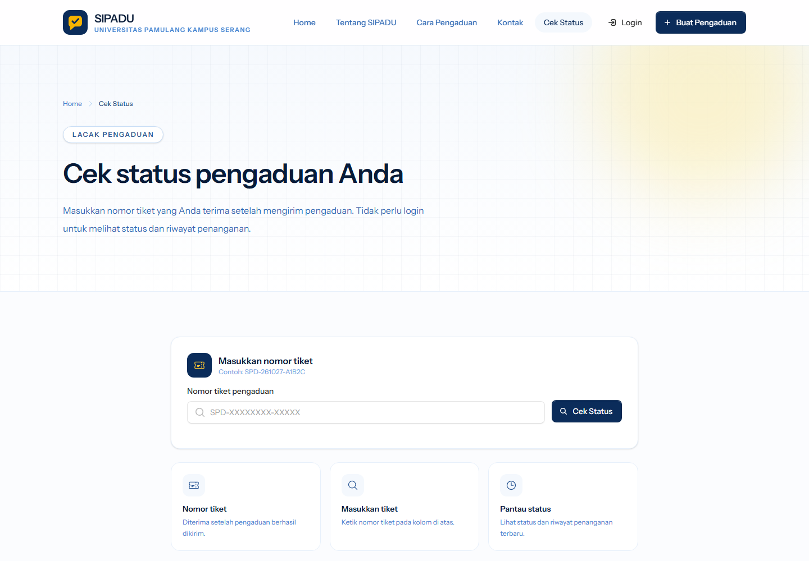
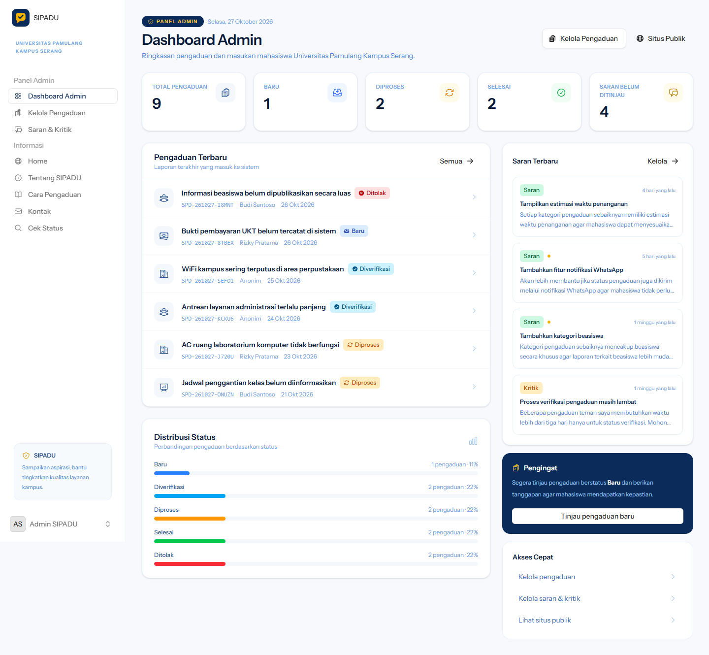

# SIPADU

**Sistem Pengaduan Mahasiswa — Universitas Pamulang Kampus Serang**


SIPADU adalah website untuk menyampaikan pengaduan, saran, dan kritik mahasiswa. Mahasiswa dapat mengirim laporan, mengunggah bukti pendukung, dan memantau status penanganan. Admin kampus dapat memverifikasi laporan, memperbarui status, dan memberikan tanggapan.



---

## Mulai Cepat (Windows)

Panduan ini untuk komputer yang sudah memiliki **Laragon**, **Git**, dan **Composer**. Kalau belum, lihat bagian [Persiapan](#persiapan).

### 1. Buka Laragon

Buka **Laragon**, lalu klik **Start All**. Pastikan **MySQL** berwarna hijau/running.

### 2. Buka terminal

Gunakan **Laragon Terminal** (tombol **Terminal** di Laragon) atau terminal di **VSCode**.

### 3. Clone dan setup

Jalankan perintah berikut satu per satu:

```bash
git clone https://github.com/ItsGass/siPADU.git
cd siPADU
.\setup.bat
```

`setup.bat` akan otomatis:

- membuat file `.env`,
- menginstall dependensi PHP,
- membuat application key,
- membuat database `sipadu`,
- membuat tabel dan mengisi data contoh.

> **Penting:** `setup.bat` akan mengosongkan database `sipadu` dan mengisi ulang data demo. Jalankan sekali saat pertama kali. Jangan jalankan lagi setelah ada data asli.

### 4. Jalankan aplikasi

```bash
.\start.bat
```

Browser akan terbuka otomatis di:

**http://127.0.0.1:8000**

Jangan tutup jendela terminal selama memakai aplikasi. Tekan `Ctrl+C` atau tutup jendelanya untuk menghentikan server.

> Kalau memakai **Command Prompt**, perintah `.\setup.bat` dan `.\start.bat` juga bisa ditulis `setup.bat` dan `start.bat`.

---

## Akun Demo

| Peran | Email | Password |
| --- | --- | --- |
| Admin | `admin@unpam.ac.id` | `password` |
| Mahasiswa | `mahasiswa@unpam.ac.id` | `password` |

Akun mahasiswa lain yang juga tersedia:

- `ahmad@unpam.ac.id`
- `siti@unpam.ac.id`
- `budi@unpam.ac.id`

Semua akun demo memakai password `password`.



> Ganti password demo sebelum aplikasi dipakai untuk data sungguhan.

---

## Panduan Singkat

### A. Membuat pengaduan (mahasiswa)

1. Buka **http://127.0.0.1:8000**.
2. Klik **Buat Pengaduan**.
3. Kalau belum punya akun, klik **Daftar sekarang** dan isi:
   - nama lengkap,
   - NIM,
   - program studi,
   - email,
   - password.
4. Login memakai akun yang baru dibuat.
5. Pilih kategori pengaduan:
   - Akademik
   - Fasilitas Kampus
   - Pelayanan Administrasi
   - Keuangan & Pembayaran
   - Dosen & Pembelajaran
   - Lainnya
6. Isi judul dan kronologi kejadian. Kronologi minimal 30 karakter.
7. Lokasi dan tanggal kejadian boleh dikosongkan.
8. Unggah bukti pendukung jika ada:
   - format JPG, PNG, WEBP, atau PDF,
   - maksimal 5 file,
   - maksimal 5 MB per file.
9. Aktifkan **Sembunyikan identitas saya (anonim)** kalau nama tidak ingin ditampilkan.
10. Klik **Kirim Pengaduan**.
11. Simpan **nomor tiket** yang muncul, contohnya `SPD-261027-A1B2C`.



### B. Memantau pengaduan

- Buka menu **Pengaduan Saya** untuk melihat semua laporan.
- Klik salah satu laporan untuk melihat status dan riwayat tanggapan admin.
- Buka **Cek Status** kalau ingin mengecek tanpa login.

### C. Cek status tanpa login

1. Buka menu **Cek Status**.
2. Masukkan nomor tiket, contoh `SPD-261027-A1B2C`.
3. Klik **Cek Status**.
4. Status dan riwayat penanganan akan ditampilkan.



### D. Mengirim saran atau kritik

1. Login sebagai mahasiswa.
2. Buka menu **Saran & Kritik**.
3. Pilih jenis **Saran** atau **Kritik**.
4. Isi subjek dan pesan.
5. Aktifkan opsi anonim jika perlu.
6. Kirim.

### E. Mengelola pengaduan (admin)

1. Login memakai akun admin:
   - email: `admin@unpam.ac.id`
   - password: `password`
2. Setelah login, admin diarahkan ke **/admin**.
3. Buka **Kelola Pengaduan** untuk:
   - mencari pengaduan,
   - memfilter berdasarkan status atau kategori,
   - membuka detail laporan,
   - mengubah status dan prioritas,
   - menulis tanggapan resmi.
4. Buka **Saran & Kritik** untuk meninjau saran/kritik mahasiswa.
5. Gunakan **Lihat situs publik** untuk kembali ke halaman utama.



---

## Alur Status Pengaduan

| Status | Arti |
| --- | --- |
| `baru` | Pengaduan baru masuk dan belum diperiksa. |
| `diverifikasi` | Pengaduan sudah diperiksa dan dianggap valid. |
| `diproses` | Pengaduan sedang ditangani oleh unit terkait. |
| `selesai` | Pengaduan sudah diselesaikan. |
| `ditolak` | Pengaduan ditolak atau tidak dapat ditindaklanjuti. |

Alur normal:

```text
baru -> diverifikasi -> diproses -> selesai
```

Pengaduan juga dapat berakhir di `ditolak` setelah diverifikasi.

---

## Persiapan

Minimal yang dibutuhkan:

- **Windows 10/11**
- **Laragon Full** — sudah berisi PHP, MySQL, dan Composer.
- **Git** — untuk clone repository.
- **Browser** — Chrome, Edge, Firefox, atau lainnya.

Opsional:

- **VSCode** — untuk membuka dan mengedit kode.
- **Node.js 20+** — hanya diperlukan kalau ingin mengubah tampilan/CSS/JavaScript. Untuk menjalankan aplikasi saja, Node.js **tidak wajib** karena hasil build sudah disertakan di folder `public/build`.

### Kalau belum punya Git

Download repository dalam bentuk ZIP:

1. Buka https://github.com/ItsGass/siPADU
2. Klik tombol hijau **Code**.
3. Pilih **Download ZIP**.
4. Extract ke folder, misalnya `C:\laragon\www\siPADU`.
5. Buka terminal di folder tersebut, lalu jalankan `.\setup.bat` dan `.\start.bat`.

### Kalau PHP atau Composer tidak dikenali

Gunakan **Laragon Terminal**, bukan Command Prompt biasa. Laragon Terminal sudah mengatur PATH untuk PHP dan Composer.

`setup.bat` juga sudah mencoba mencari PHP dan Composer di lokasi default Laragon:

```text
C:\laragon\bin\php\php-*\php.exe
C:\laragon\bin\composer\composer.bat
```

---

## Cara Manual (Kalau setup.bat Gagal)

Kalau `setup.bat` tidak berjalan, ikuti langkah berikut dari terminal di folder project.

### 1. Salin file environment

```bash
copy .env.example .env
```

### 2. Install dependensi PHP

```bash
composer install
```

### 3. Buat application key

```bash
php artisan key:generate
```

### 4. Buat database

Cara otomatis:

```bash
php scripts/create-database.php
```

Atau lewat **phpMyAdmin**:

1. Buka Laragon → **Database**.
2. Buat database bernama `sipadu`.
3. Pilih collation `utf8mb4_unicode_ci`.

### 5. Buat tabel dan data contoh

```bash
php artisan migrate:fresh --seed
```

### 6. Jalankan server

```bash
php artisan serve
```

Buka **http://127.0.0.1:8000**.

### Kalau password MySQL tidak kosong

Secara default Laragon memakai user `root` tanpa password. Kalau MySQL Anda memakai password, edit file `.env`:

```env
DB_HOST=127.0.0.1
DB_PORT=3306
DB_DATABASE=sipadu
DB_USERNAME=root
DB_PASSWORD=password_mysql_anda
```

Lalu jalankan ulang:

```bash
php scripts/create-database.php
php artisan migrate:fresh --seed
```

---

## Troubleshooting

### `PHP tidak ditemukan` atau `Composer tidak ditemukan`

- Buka **Laragon Terminal**, lalu jalankan `setup.bat` dari sana.
- Pastikan Laragon sudah terinstall lengkap.
- Tutup terminal lama, buka terminal baru, lalu coba lagi.

### `Gagal membuat database` / `Connection refused`

- Buka Laragon, klik **Start All**.
- Pastikan MySQL berjalan dan port `3306` tidak dipakai aplikasi lain.
- Coba buka phpMyAdmin dari Laragon.

### `Access denied for user 'root'`

- Buka `.env`.
- Sesuaikan `DB_USERNAME` dan `DB_PASSWORD` dengan akun MySQL Anda.
- Jalankan lagi `php scripts/create-database.php`.

### `Unknown database 'sipadu'`

Database belum dibuat. Jalankan:

```bash
php scripts/create-database.php
php artisan migrate:fresh --seed
```

### Port 8000 sudah dipakai

Tutup terminal lain yang sedang menjalankan `php artisan serve`, lalu jalankan `start.bat` lagi.

Alternatif, jalankan manual di port lain:

```bash
php artisan serve --port=8001
```

Lalu buka `http://127.0.0.1:8001`.

### `Vite manifest not found`

Folder `public/build` hilang atau belum dibangun. Kalau Node.js tersedia:

```bash
npm install
npm run build
```

Kalau tidak ingin memakai Node.js, clone ulang repository karena folder `public/build` sudah disertakan di repo.

### Halaman blank atau error 500

Jalankan:

```bash
php artisan optimize:clear
```

Lalu cek log:

```text
storage/logs/laravel.log
```

### `Class not found`

Jalankan:

```bash
composer dump-autoload
php artisan optimize:clear
```

### Ingin mengulang setup dari awal

> **Peringatan:** perintah ini menghapus semua data di database `sipadu`.

```bash
php artisan migrate:fresh --seed
```

### PowerShell menolak `npm.ps1`

Gunakan `npm.cmd`:

```bash
npm.cmd install
npm.cmd run build
```

---

## Untuk Pengembang

### Menjalankan dalam mode pengembangan

```bash
composer install
npm install
php artisan serve
npm run dev
```

### Build aset frontend

```bash
npm run build
```

### Menjalankan test

Test memakai database MySQL `sipadu_testing`.

Buat database testing:

```bash
php scripts/create-database.php sipadu_testing
```

Jalankan test:

```bash
php artisan test
```

Atau jalankan semua pemeriksaan:

```bash
composer ci:check
```

### GitHub Actions

Workflow `.github/workflows/tests.yml` otomatis:

- menyiapkan PHP 8.3 dan Node.js 22,
- menjalankan service MySQL 8,
- membuat database `sipadu` dan `sipadu_testing`,
- menginstall dependensi,
- menjalankan Pint, PHPStan, dan Pest.

---

## Struktur Folder Penting

| Lokasi | Isi |
| --- | --- |
| `app/` | Logika aplikasi, model, dan Livewire component. |
| `resources/views/` | Tampilan halaman dan komponen Blade. |
| `routes/web.php` | Daftar route halaman publik, mahasiswa, dan admin. |
| `database/seeders/DatabaseSeeder.php` | Data contoh dan akun demo. |
| `public/build/` | Hasil build CSS/JS yang sudah disertakan. |
| `storage/app/private/` | Bukti pengaduan yang disimpan privat. |
| `setup.bat` | Setup otomatis untuk Windows. |
| `start.bat` | Menjalankan server lokal dan membuka browser. |
| `docs/screenshots/` | Gambar untuk dokumentasi. |

---

## Keamanan

- File `.env` tidak ikut di-commit. Jangan pernah membagikan isi `.env`.
- Bukti pengaduan disimpan di `storage/app/private` dan hanya bisa diakses pemilik laporan atau admin.
- Ganti password akun demo sebelum dipakai untuk data sungguhan.
- Untuk penggunaan produksi:
  - set `APP_ENV=production`,
  - set `APP_DEBUG=false`,
  - gunakan password database yang kuat,
  - gunakan layanan email sungguhan,
  - pasang HTTPS.

---

## Teknologi

- Laravel 13
- Livewire 4
- Flux UI 2
- Tailwind CSS 4 + Vite
- MySQL 8
- Pest

---

Dibuat untuk **Universitas Pamulang Kampus Serang**.
